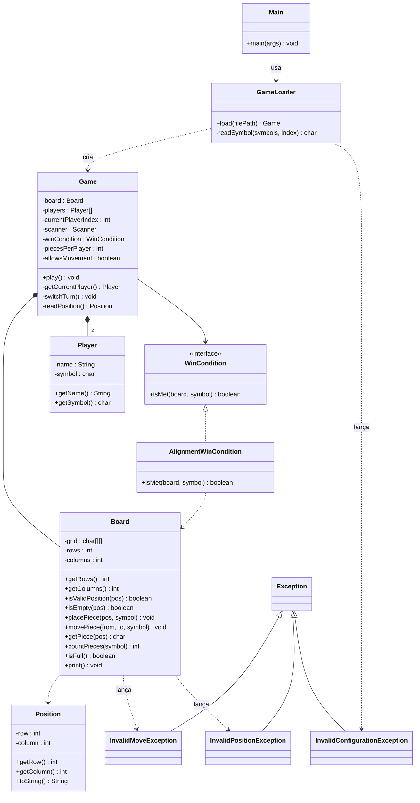

# Diagrama de classes

Diagrama do Checkpoint 2. O GitHub desenha o bloco abaixo sozinho; a mesma figura também está em `diagrama-de-classes.png`, para quem abrir o arquivo fora do GitHub.

## Como ler

Setas tracejadas indicam dependência (uma classe usa a outra, sem guardá-la como atributo). Losango preenchido indica composição: o `Game` guarda o `Board` e os dois `Player`. A seta cheia do `Game` para `WinCondition` é uma associação: o jogo guarda uma regra de vitória, mas não sabe qual implementação é.

## O que mudou desde o Checkpoint 1

- `WinCondition` é uma interface, e `AlignmentWinCondition` a implementa. O `Game` só conhece a interface, então trocar a regra de vitória não exige mexer nele.
- `GameLoader` é novo. Ele lê o JSON, valida e monta o `Game` pronto.
- `InvalidConfigurationException` é nova e cobre os erros de arquivo de configuração.
- `Game` recebe `piecesPerPlayer` e `allowsMovement`. Com `allowsMovement` verdadeiro, ele passa por uma fase de colocar peças e depois por uma fase de mover (Picaria). Com falso, só coloca (jogo da velha).
- `Board` ganhou `movePiece`, `countPieces`, `getRows` e `getColumns`.
